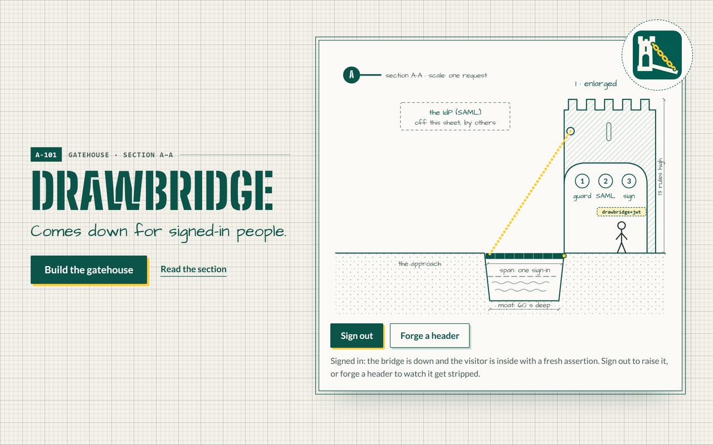
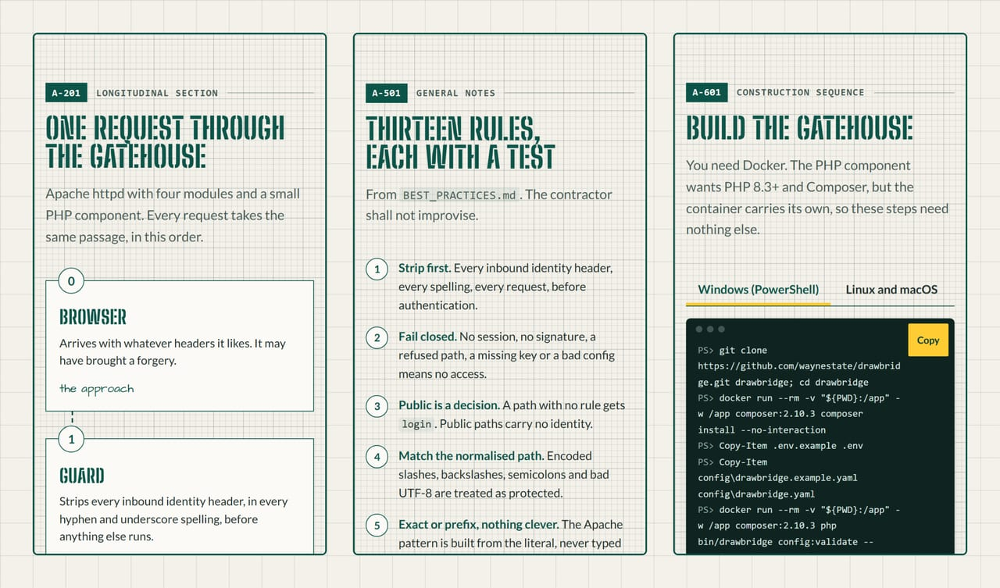
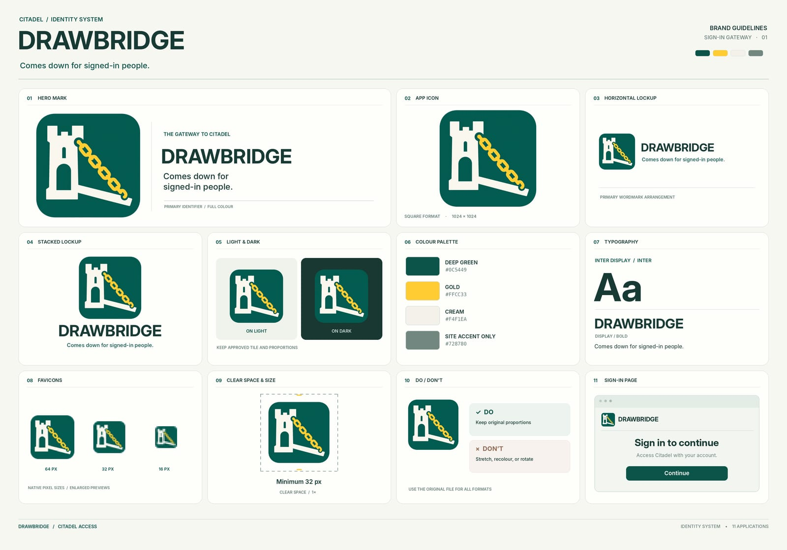

<div align="center">
  <a href="site/index.html"></a>
</div>

# DRAWBRIDGE

<div align="center">
  
  
  
  <a href="https://github.com/waynestate/drawbridge/actions/workflows/ci.yml"></a>
</div>

**Comes down for signed-in people.**

Checks: `composer ci` (the same command runs on GitLab and GitHub). The container rig has its own script, see "Run the checks".

> The one way into the Citadel. It only comes down for people who signed in.

DRAWBRIDGE is the Citadel auth gateway at `auth.apps.wayne.edu`: one OpenID Connect client, signed in through
Microsoft Entra ID, for every app on the platform. It sits in front of the apps as a reverse proxy, makes sure the
visitor has a session, throws away any identity header the visitor tried to bring along, and passes the app either a
short-lived signed assertion that SESAME's `gateway` driver verifies, or plain `X-Authenticated-*` headers for apps
that cannot verify a token yet. Which paths need a login, and which need an Entra authentication context on top, is
declared per app in a config file. Nothing else decides it.

Why a moat and not a lock on each door: every app doing its own OpenID Connect is another chance to get a nonce,
a state check or a token signature wrong. DRAWBRIDGE does the sign-in once, in a maintained module
(mod_auth_openidc), and every app only has to check one small signed token.

This repository is published from Wayne State University's internal GitLab and mirrored here. Changes land there
first.

## Where it fits in WELD

WELD is the Wayne State application stack: one contract, several paths that agree, accessibility as a gate, and
decisions written down.

| Part | Job |
|---|---|
| WayneUI | the interface layer (project 0 of the stack) |
| CREED | the shared rules and policy format |
| PROCTOR | checks an app against the version policy |
| PREFLIGHT | the shared CI components |
| SESAME | sign-in inside the app; its `gateway` driver verifies what DRAWBRIDGE signs |
| HELMET | security headers and CSP reporting |
| Pinstripe | the Laravel example that wears all of it |
| Sourdough | the starter that keeps the stack fed |
| **DRAWBRIDGE** | **the one OpenID Connect front door for the Citadel** |

## How it works

```
browser --> Apache httpd (DRAWBRIDGE) --> app container
              |  mod_auth_openidc : OpenID Connect client (Entra ID), one session cookie per app host
              |  mod_lua          : strips identity headers on every request, before anything else
              |  mod_rewrite      : asks the PHP signer for an assertion (prg: map)
              |  mod_proxy        : forwards to the app
              `- PHP component    : validates the config, renders the Apache config, signs assertions (ES256)
```

<div align="center">
  
  <br>
  <sub>Detail 1, enlarged: the three rooms of the passage, labelled from the source. The drawing inks itself in, and holds still if you have asked your system for less motion.</sub>
</div>

- A request for a **protected** path without a session is redirected to Entra (authorization code flow with PKCE).
  For an **api** path it gets a plain 401, so a script is never handed an HTML login page. A **public** path passes
  through with no identity at all.
- mod_auth_openidc checks the ID token (signature, issuer, audience, nonce, expiry) and keeps the session. The
  claims reach the gateway in the request environment only, never as headers, and no Entra token is passed to an app.
- The assertion is a compact JWT with `typ: drawbridge+jwt` and a `kid`. Claims: `iss` (DRAWBRIDGE, never Entra),
  `aud` (the app's host), `sub` (the configured user claim, `preferred_username` by default), `iat`, `nbf`, `exp`
  (60 seconds by default), `jti`; `auth_time`, `amr` and `acrs` when the ID token carries them; `email`, `name` and
  `affiliations` when configured; and any `extra_claims` (for example `wsuRoles`). A new one is minted for every
  request, and only from an ID token whose `iss` is the configured provider.
- If the signer cannot sign, the answer is 503. A request never reaches the app unsigned.
- Header stripping: the guard removes every inbound `X-Authenticated-*`, `X-Sesame-*`, `X-Drawbridge-*`,
  `OIDC_CLAIM_*`, `OIDC_access_token` (and the module's other token names), `Remote-User`, `X-Forwarded-*`,
  `Forwarded` and similar header, in every hyphen and underscore spelling, on every request, before authentication
  runs. Every header under an owned prefix goes, whatever follows the prefix. It also trims `Connection` to `close`,
  `keep-alive` and `upgrade`, so a client cannot ask the proxy to drop a header the gateway set.

### Step-up with an authentication context

A path rule can name an Entra authentication context (`c1` to `c99`):

```yaml
protected:
  - /admin/
  - path: /admin/payroll/
    auth_context: c1
```

On that path the gateway asks Entra for the context with the OpenID Connect `claims` request parameter
(`{"id_token":{"acrs":{"essential":true,"value":"c1"}}}`) and lets the request through only when the ID token's
`acrs` array lists `c1`. A visitor already signed in without it is sent back to Entra to step up (mod_auth_openidc
answers with a short page that forwards the browser); an `api` path answers 401. What `c1` actually demands (MFA,
a compliant device, a fresh sign-in) is a Conditional Access policy in Entra, not DRAWBRIDGE config. The check is
made twice: by mod_auth_openidc's `Require claim acrs:c1`, and again by the gateway's own stamp step.

### Signing out

An app links to `/_drawbridge/oidc/callback?logout=<URL-encoded address on the same host>`. mod_auth_openidc ends
the gateway session for that host and sends the browser through Entra's sign-out endpoint (named in the provider's
discovery document) back to the address. An address on another host is refused, so the link cannot be used to bounce
visitors elsewhere.

## Install and quick start

You need Docker. The PHP component needs PHP 8.3 or newer and Composer, but the container carries its own.

**Windows (PowerShell)**

```powershell
git clone https://github.com/waynestate/drawbridge.git; cd drawbridge
docker run --rm -v "${PWD}:/app" -w /app composer:2.10.3 composer install --no-interaction
Copy-Item .env.example .env
Copy-Item config\drawbridge.example.yaml config\drawbridge.yaml
docker run --rm -v "${PWD}:/app" -w /app composer:2.10.3 php bin/drawbridge config:validate --config=config/drawbridge.yaml
docker build -f docker/gateway/Dockerfile -t drawbridge-gateway .
```

**Linux and macOS**

```sh
git clone https://github.com/waynestate/drawbridge.git && cd drawbridge
docker run --rm -v "$PWD:/app" -w /app composer:2.10.3 composer install --no-interaction
cp .env.example .env
cp config/drawbridge.example.yaml config/drawbridge.yaml
docker run --rm -v "$PWD:/app" -w /app composer:2.10.3 php bin/drawbridge config:validate --config=config/drawbridge.yaml
docker build -f docker/gateway/Dockerfile -t drawbridge-gateway .
```

With PHP installed locally the same commands are `composer install` and `php bin/drawbridge ...`.

Then run the image with the two files it cannot start without mounted read-only, and the two secrets in its
environment (the entrypoint refuses to start if any is missing, and `render` refuses an unusable secret):

| Item | What it is |
|---|---|
| `drawbridge.yaml` (file) | the per-app config, including the `oidc` block |
| `signing.key` (file) | the ES256 key that signs assertions (`keys:generate` makes one) |
| `DRAWBRIDGE_OIDC_CLIENT_SECRET` (env) | the Entra client secret (the variable name is `oidc.client_secret_env`) |
| `DRAWBRIDGE_OIDC_CRYPTO_PASSPHRASE` (env) | mod_auth_openidc's crypto passphrase, at least 32 characters |

```sh
docker run --rm -p 8080:8080 --env-file .env \
  -v "$PWD/config/drawbridge.yaml:/etc/drawbridge/drawbridge.yaml:ro" \
  -v "$PWD/secrets:/run/drawbridge:ro" drawbridge-gateway
```

The secrets are never written into the rendered Apache config: it says `OIDCClientSecret "${DRAWBRIDGE_OIDC_CLIENT_SECRET}"`
and Apache reads the value from its environment. Keys and secrets are never in git. `OPEN_QUESTIONS.md` lists where
each real one comes from.

### Register DRAWBRIDGE in Entra ID

One app registration covers every app host. In the Entra admin center, under App registrations:

1. **New registration.** Single tenant. Platform **Web**.
2. **Redirect URIs.** One per app host: `https://<app host>/_drawbridge/oidc/callback` (for example
   `https://app1.apps.wayne.edu/_drawbridge/oidc/callback`). Each host gets its own session, so each needs its own
   redirect URI; add one whenever an app is added to the config. Leave the implicit grant boxes unticked: the gateway
   uses the authorization code flow with PKCE.
3. **Certificates & secrets.** Make a client secret and put it in the deployment's secret store as
   `DRAWBRIDGE_OIDC_CLIENT_SECRET`. Note its expiry date: Entra secrets expire, and the gateway cannot sign anyone in
   once it has (see `OPEN_QUESTIONS.md`, secret rotation).
4. **Token configuration.** Add the optional ID token claims the config reads: `email`, `auth_time`, and `acrs` if any
   path uses an authentication context. A deployment that wants a different `sub` (for example an `alias` claim) adds
   it here and sets `oidc.user_claim`. Any directory extension (such as `wsuRoles`) is added the same way and listed
   in `oidc.extra_claims`.
5. **Overview.** Copy the Directory (tenant) ID into `oidc.issuer`
   (`https://login.microsoftonline.com/<tenant-id>/v2.0`) and the Application (client) ID into `oidc.client_id`.
   Neither is a secret, but neither belongs in this repository either.
6. **Authentication contexts** (only if a path uses `auth_context`): in Conditional Access, create the context
   (`c1` ...), and a policy that targets it with whatever it should demand.

## Getting the image

The pipeline builds the gateway image on every merge request and on the default branch, and publishes it to this
project's GitLab container registry when a tag is pushed. The image is at `<this project's registry>/gateway:<tag>`
(for example `<this project's registry>/gateway:0.2.0`). There is no `latest` tag: pin a release.

```sh
docker pull <this project's registry>/gateway:0.2.0
```

The publish job prints the digest it pushed. Verify the image you pulled against it:

```sh
docker inspect --format='{{index .RepoDigests 0}}' <this project's registry>/gateway:0.2.0
```

The image carries OCI labels (`org.opencontainers.image.source`, `.revision`, `.version`, `.licenses`) set from the
pipeline's commit; a local `docker build` leaves them empty.

## Configuration

One YAML (or PHP array) file declares the gateway, the OpenID Connect provider and each app.
`config/drawbridge.example.yaml` is annotated.

```yaml
oidc:
  issuer: https://login.microsoftonline.com/<tenant-id>/v2.0
  client_id: <application-client-id>
  client_secret_env: DRAWBRIDGE_OIDC_CLIENT_SECRET   # the NAME of the variable, never the secret
  user_claim: preferred_username                     # or another claim, such as "alias", once Entra releases it
  extra_claims: [wsuRoles]                           # copied into the assertion when present

apps:
  - id: app1
    host: app1.apps.wayne.edu
    upstream: http://app1:8080
    mode: assertion          # or "headers", or "both"
    default: login           # what a path with no rule gets
    public: [/up, /assets/]
    protected: [/admin/, {path: /admin/payroll/, auth_context: c1}]
    api: [/api/]
```

The `oidc` block also takes `metadata_url` (defaults to the issuer's `/.well-known/openid-configuration`),
`attribute_claims` (which claim feeds `email`, `name` and `affiliations`; `null` turns one off) and `amr_map` (Entra
`amr` values to the values SESAME's MFA check reads; the default maps `pwd`, `mfa`, `ngcmfa` as `mfa`, `otp`, `rsa`,
`wia`, and the REFEDS MFA URI). The issuer must be https; plain http is accepted only for a `.test` host, which is what
the local rig uses.

Path rules are exact (`/up`) or prefix (a trailing slash, `/assets/`). There are no wildcards and no regular
expressions. The longest rule wins, and an exact rule beats a prefix of the same length. Query strings are never part
of the match. A path with an encoded slash, a backslash, a semicolon, a control character or bad UTF-8 is treated as
`login` (and the guard answers 400). `/_drawbridge` belongs to the gateway.

## Environment variables

| Variable | Default | Meaning |
|---|---|---|
| `DRAWBRIDGE_CONFIG` | `/etc/drawbridge/drawbridge.yaml` | the per-app config file |
| `DRAWBRIDGE_PORT` | `8080` | port Apache listens on (non-root, so above 1024) |
| `DRAWBRIDGE_PUBLIC_SCHEME` | `https` | how browsers reach the gateway; feeds `ServerName`, `X-Forwarded-Proto`, the redirect URI |
| `DRAWBRIDGE_PUBLIC_PORT` | empty | public port when it is not the scheme default |
| `DRAWBRIDGE_COOKIE_SECURE` | `true` | Secure session cookie; `false` only for a plain-HTTP local rig |
| `DRAWBRIDGE_TRUSTED_PROXIES` | empty | comma-separated CIDRs allowed to set `X-Forwarded-For`; empty trusts nobody |
| `DRAWBRIDGE_OIDC_CLIENT_SECRET` | none, required | the Entra client secret (or whichever name `oidc.client_secret_env` gives) |
| `DRAWBRIDGE_OIDC_CRYPTO_PASSPHRASE` | none, required | encrypts state cookies and sessions; 32+ characters; changing it signs everyone out |
| `DRAWBRIDGE_SIGNING_KEY_FILE` | `/run/drawbridge/signing.key` | ES256 private key for assertions (mounted) |
| `DRAWBRIDGE_SIGNING_KEY_ID` | `drawbridge-1` | `kid` in each token header; change it when the key changes |
| `DRAWBRIDGE_SESSION_CACHE_ENTRIES` | `1000` | entries in the shared-memory cache: sessions, nonces, provider metadata (minimum 10) |
| `DRAWBRIDGE_RUN_DIR` | `/tmp/drawbridge` | scratch for rendered config, locks and the session cache |
| `DRAWBRIDGE_LOG_LEVEL` | `warn` | Apache log level |
| `DRAWBRIDGE_METRICS_TOKEN` | none | bearer token that may read `/metrics`; empty turns the endpoint off unless an allow list is set |
| `DRAWBRIDGE_METRICS_ALLOW` | none | comma list of client IPs/CIDRs allowed to read `/metrics`; empty trusts no address |

## Commands

Run as `php bin/drawbridge <command>` (or `vendor/bin/drawbridge` when installed as a dependency).

| Command | Does |
|---|---|
| `config:validate` | checks the config and prints every problem at once, then the provider settings (never the secret, only whether its variable is set); exit 1 if any |
| `explain <host> <path>` | says which rule applies to a request, and which authentication context it needs, and why |
| `render` | checks the two secrets in the environment, then writes `apps.conf` and `policy.lua` for Apache (the entrypoint runs this) |
| `keys:generate` | makes an ES256 key pair; refuses to overwrite a file |
| `signer:map` | the long-running process behind Apache's `prg:` map (not for people) |

## Run the checks

```sh
composer ci          # manifest, unit tests, Pint, PHPStan level 8, composer audit
```

In Docker, with no local PHP:

```powershell
docker run --rm -v "${PWD}:/app" -w /app composer:2.10.3 sh -c "composer install --no-interaction && composer ci"
```

The unit suite checks the assertion against a mirror of SESAME's `gateway` driver rules
(`tests/Support/SesameContract.php`). To check it against the real driver instead, point `SESAME_PATH`
at a SESAME checkout that has been installed (`composer install` in it) and run the integration suite;
without it the suite skips, so `composer ci` stays green:

```powershell
docker run --rm -v "${PWD}:/app" -v "C:\path\to\sesame:/sesame:ro" -e SESAME_PATH=/sesame -w /app composer:2.10.3 sh -c "composer install --no-interaction && vendor/bin/phpunit --filter RealSesame"
```

The container rig runs the real gateway image with a mock OpenID Connect provider
([mock-oauth2-server](https://github.com/navikt/mock-oauth2-server), pinned) standing in for Entra, and a tiny echo
app. It covers sign-in, public and protected paths, header spoofing (including forged `OIDC_*` headers), path tricks,
forged callbacks, step-up to an authentication context, signature checks against SESAME's `gateway` driver rules, and
logout. The mock signs in anyone with whatever claims the test types into its form, which is exactly what you want
from a stunt double. Nothing in the rig reaches Entra.

```powershell
rig\run.ps1          # Windows
```

```sh
sh rig/run.sh        # Linux, macOS
```

## Using the assertion in an app

Point SESAME's `gateway` driver at DRAWBRIDGE: the same issuer, the app's host as the audience, the signing public
key, and the header `X-Sesame-Assertion`. Apps do not parse the token themselves.

## Metrics

DRAWBRIDGE can expose a Prometheus `/metrics` endpoint, off by default. It is on when `DRAWBRIDGE_METRICS_TOKEN`
(a bearer token) or `DRAWBRIDGE_METRICS_ALLOW` (a comma list of client IPs/CIDRs) is set, and a request is served
when it presents the token or comes from an allowed address. A disabled or misconfigured endpoint answers 404 and an
unauthorized request answers 403, so the route is never advertised and never served to a stranger. The client
address is `REMOTE_ADDR` (the real client), never a client-supplied header, so a spoofed `X-Forwarded-For` cannot
grant access, and the token is compared in constant time.

Point a web server at `bin/metrics` for the path. In the rendered Apache config a location such as:

```apache
<Location "/metrics">
    SetEnvIf Authorization "(.*)" HTTP_AUTHORIZATION=$1
    ScriptAlias /metrics /opt/drawbridge/bin/metrics
</Location>
```

serves it (the `SetEnvIf` passes the bearer token through; without it only the allow list works).

The endpoint serves only what it can see truthfully:

| Metric | Type | Meaning |
|---|---|---|
| `drawbridge_build_info{version}` | gauge | the gateway is up, and which version |

The assertion-signing counters (`drawbridge_signing_requests_total`, `drawbridge_assertions_signed_total`,
`drawbridge_assertion_errors_total{reason}`) are kept in the signer for in-process use but are not registered on the
endpoint until a shared store lets it see the signer's counters; a counter that is always zero is not shown. Apache,
not PHP, serves the requests, so request counts by path class are not exposed here either, and public requests and
sign-in failures never reach the PHP side; mod_auth_openidc would need its own status or log scraping to expose
those. Labels carry no identity, claim, or token, and the `reason` label is folded to a fixed set, so it stays
low-cardinality.

The counters live in the signer's memory. The endpoint is a separate, per-request process, so by default (the
`InMemory` adapter) it reports build info only. To share the signer's live counters with the endpoint, pass the same
shared adapter (for example `Prometheus\Storage\APCng`, which needs the APCu extension) to both; without a shared
store, PHP's share-nothing model cannot see across processes.

## Documents

- `BEST_PRACTICES.md`: the short list of rules the gateway holds itself to.
- `OPEN_QUESTIONS.md`: what is unanswered, what is missing, what is not built yet.
- `CHANGELOG.md`: what changed.
- `site/`: the front page, a static sheet set for the gatehouse (`site/index.html`; see `site/README.md`).

<details>
<summary><b>Sheets</b>: three windows onto the gatehouse</summary>
<br>
<div align="center"></div>
</details>

<details>
<summary><b>The brand board</b>: the mark, lockups, palette and type</summary>
<br>
<div align="center"></div>
</details>

## The name

It is a drawbridge, so it goes up on strangers and down on friends. If you find a header it should have caught,
raise the issue. The moat is only as good as the people who keep reporting where it is shallow.

## Licence

MIT. Copyright Wayne State University.

<div align="center"><b>Same castle, every sheet</b><br><sub>WayneUI and the stack. DRAWBRIDGE minds the gate.</sub></div>

<div align="center">
  <a href="https://github.com/waynestate/wayne-ui" title="WayneUI"></a>
  <a href="https://github.com/waynestate/creed" title="CREED"></a>
  <a href="https://github.com/waynestate/proctor" title="PROCTOR"></a>
  <a href="https://github.com/waynestate/sesame" title="SESAME"></a>
  <a href="https://github.com/waynestate/helmet" title="HELMET"></a>
  <a href="https://github.com/waynestate/sourdough" title="Sourdough"></a>
  <a href="https://github.com/waynestate/squire" title="SQUIRE"></a>
  <a href="https://github.com/waynestate/preflight" title="PREFLIGHT"></a>
  <a href="https://github.com/waynestate/pinstripe" title="Pinstripe"></a>
  <a href="https://github.com/waynestate/booster" title="BOOSTER"></a>
  <a href="https://github.com/waynestate/rollcall" title="ROLLCALL"></a>
  <a href="https://github.com/waynestate/drawbridge" title="DRAWBRIDGE"></a>
  <a href="https://github.com/waynestate/advisor" title="ADVISOR"></a>
  <a href="https://github.com/waynestate/weld" title="WELD"></a>
</div>

<div align="center"><sub>Images are regenerated from the front page and the source by <a href="scripts/readme-art/README.md"><code>scripts/readme-art</code></a>. Drawn, not quartered.</sub></div>
